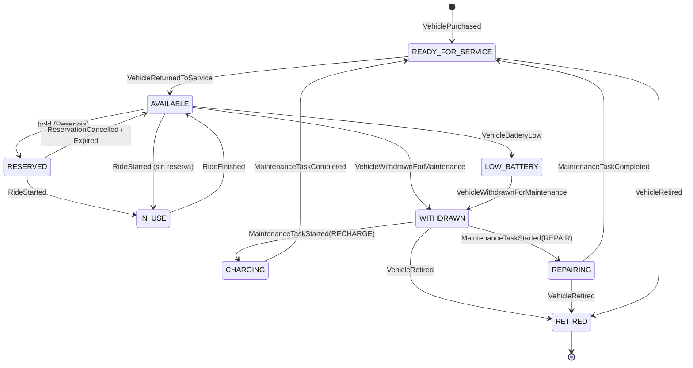

> **ARCHIVADO (4 nov 2026): no es la línea de trabajo vigente.** El grupo decidió definir
> primero la arquitectura de microservicios a alto nivel y resolver los detalles técnicos a
> medida que surjan (ver [acuerdos.md](acuerdos.md)). Este documento adelantaba decisiones
> que el grupo aún no ha planteado. **Nada de lo que contiene está acordado.** Se conserva
> solo como material de consulta cuando se llegue a cada tema.

# Propuesta para cerrar los bloqueantes (4 nov 2026)

Propuesta para discutir en grupo. **Nada de esto está decidido.** Cuando el grupo acepte un
punto, se traslada a su ficha (se quita la marca `PENDIENTE`) y, si es una decisión
arquitectónica, se registra como ADR. Orden: de lo que más condiciona a lo que menos.

## 1. Dueño del estado operativo del recurso

**Propuesta: [Disponibilidad](../02-servicios/disponibilidad.md) es el dueño del estado operativo.**
[Inventario](../02-servicios/inventario-de-recursos.md) es dueño del activo (identificador,
tipo, modelo, fecha de compra) y de un estado administrativo con solo dos valores:
`ACTIVE` y `RETIRED`.

Por qué:
- Disponibilidad ya existe para "mantener qué recursos pueden reservarse" y ya tiene que
  escuchar casi todos los eventos de cambio de estado.
- Inventario queda estable (casi sin cambios), lo que evita mezclar inventario, reservas y
  mantenimiento (§4.1).
- Es una sola tabla con una sola máquina de estados, fácil de explicar en la defensa.

Alternativa descartada: Inventario como dueño. Obligaría a que reservas y viajes cambien el
estado de un servicio que debería ser casi estático.

Consecuencia: Disponibilidad rechaza cualquier transición que no esté en la tabla del
apartado 2 y la deja registrada en logs (con el identificador de correlación).

## 2. Máquina de estados del recurso

Decisiones sobre los huecos de [estados-recurso.md](../01-arquitectura/estados-recurso.md):

- Estado inicial tras `VehiclePurchased`: `READY_FOR_SERVICE`. Un recurso nuevo se revisa
  antes de salir; `VehicleReturnedToService` lo pasa a `AVAILABLE`. Para la demo, las semillas
  cargan recursos ya en `AVAILABLE`.
- Tras `RideFinished`: siempre `AVAILABLE`. La batería no se mira aquí. Si es baja, la
  detecta Batería/Lambda y publica `VehicleBatteryLow`, que lleva a `LOW_BATTERY`.
- Todo recurso que vuelve a la calle pasa por `READY_FOR_SERVICE`.
- Cuatro eventos nuevos (ver apartado 3): `MaintenanceTaskStarted`,
  `MaintenanceTaskCompleted`, `VehicleRetired` y `ReservationConfirmed`.

| Desde | Hacia | Evento / llamada | Valida |
|---|---|---|---|
| (nuevo) | `READY_FOR_SERVICE` | `VehiclePurchased` | Disponibilidad |
| `READY_FOR_SERVICE` | `AVAILABLE` | `VehicleReturnedToService` | Disponibilidad |
| `AVAILABLE` | `RESERVED` | llamada síncrona `hold` desde Reservas (+ `VehicleReserved`) | Disponibilidad |
| `RESERVED` | `AVAILABLE` | `ReservationCancelled` / `ReservationExpired` | Disponibilidad |
| `RESERVED` | `IN_USE` | llamada síncrona `start` desde Viajes (+ `RideStarted`) | Disponibilidad |
| `AVAILABLE` | `IN_USE` | ídem, inicio sin reserva (§3.1) | Disponibilidad |
| `IN_USE` | `AVAILABLE` | `RideFinished` | Disponibilidad |
| `AVAILABLE` | `LOW_BATTERY` | `VehicleBatteryLow` | Disponibilidad |
| `AVAILABLE` o `LOW_BATTERY` | `WITHDRAWN` | `VehicleWithdrawnForMaintenance` | Disponibilidad |
| `WITHDRAWN` | `CHARGING` | `MaintenanceTaskStarted` (tipo `RECHARGE`) | Disponibilidad |
| `WITHDRAWN` | `REPAIRING` | `MaintenanceTaskStarted` (tipo `REPAIR`) | Disponibilidad |
| `CHARGING` o `REPAIRING` | `READY_FOR_SERVICE` | `MaintenanceTaskCompleted` | Disponibilidad |
| `WITHDRAWN`, `REPAIRING` o `READY_FOR_SERVICE` | `RETIRED` | `VehicleRetired` | Disponibilidad |

`RETIRED` es terminal. Los estados de las demás entidades:

| Entidad | Estados |
|---|---|
| Reserva | `CREATED` → `CONFIRMED` → (`CANCELLED` \| `EXPIRED` \| `USED`) |
| Orden de mantenimiento | `OPEN` → `IN_PROGRESS` → `COMPLETED` |
| Orden de recolocación | `ASSIGNED` → `IN_PROGRESS` → `COMPLETED` |



### Mecanismo contra la doble reserva (pregunta de defensa, §18)

Dos barreras:

1. **Barrera principal, en Disponibilidad:** Reservas llama a `POST /resources/{id}/hold`
   antes de crear la reserva. Disponibilidad hace un cambio atómico
   (`UPDATE ... SET state='RESERVED' WHERE id=? AND state='AVAILABLE'`). Si no afecta a
   ninguna fila, responde `409 Conflict` y Reservas rechaza la petición.
2. **Segunda barrera, en Reservas:** índice único parcial sobre `resource_id` para reservas
   en estado `CREATED` o `CONFIRMED`.

Si Reservas falla después del `hold`, el `hold` caduca solo (mismo timeout que la reserva) y
la [Lambda de expiración](../04-lambdas/expiracion-de-reservas.md) lo libera. Propuesta de
tiempo de expiración: **10 minutos**. La operación lleva `Idempotency-Key`.

Si Disponibilidad no responde, Reservas devuelve `503` y no crea la reserva (falla de forma
segura). Este puede ser uno de los dos escenarios de fallo de la defensa.

## 3. Catálogo de eventos

**Sobre común** (campos en inglés, camelCase):

| Campo | Nombre | Formato |
|---|---|---|
| Identificador | `eventId` | UUID v4 |
| Timestamp | `occurredAt` | ISO-8601 UTC (`2026-11-04T10:15:30Z`) |
| Origen | `source` | nombre del servicio o Lambda (`reservas`) |
| Tipo | `eventType` | nombre del catálogo (`VehicleReserved`) |
| Versión | `schemaVersion` | entero (`1`) |
| Correlación | `correlationId` | UUID v4 |
| Payload | `data` | objeto específico del evento |

Opcional: `resourceId` en el sobre, para poder particionar y ordenar por recurso.

**Productores, consumidores y payload mínimo** (todos los payloads incluyen `resourceId`
salvo `UserRegistered`):

| Evento | Productor | Consumidores | Campos de `data` |
|---|---|---|---|
| `UserRegistered` | Identidad | Perfiles, analítica | `userId`, `email` |
| `VehiclePurchased` | Adquisiciones | Inventario, Disponibilidad, analítica | `type`, `model`, `purchasedAt` |
| `VehicleReserved` | Reservas | Disponibilidad (informativo), Historial, analítica | `reservationId`, `userId`, `zoneId`, `expiresAt` |
| `ReservationConfirmed` (nuevo) | Reservas | Historial, Notificaciones | `reservationId`, `userId` |
| `ReservationCancelled` | Reservas | Disponibilidad, Historial, analítica | `reservationId`, `userId` |
| `ReservationExpired` | Lambda de expiración | Reservas, Disponibilidad, Historial, analítica | `reservationId` |
| `RideStarted` | Viajes | Reservas, Historial, analítica, Batería | `rideId`, `userId`, `originZoneId`, `reservationId?` |
| `RideFinished` | Viajes | Disponibilidad, Historial, analítica, Batería | `rideId`, `userId`, `destinationZoneId`, `durationSec`, `cost` |
| `VehicleBatteryLow` | Batería (o Lambda de detección) | Disponibilidad, Lambda de detección, analítica | `batteryLevel`, `zoneId` |
| `VehicleWithdrawnForMaintenance` | Órdenes de mantenimiento | Disponibilidad, Historial, analítica | `orderId`, `reason` |
| `MaintenanceTaskStarted` (nuevo) | Órdenes de mantenimiento | Disponibilidad, Historial | `orderId`, `taskType` (`RECHARGE` \| `REPAIR`) |
| `MaintenanceTaskCompleted` (nuevo) | Órdenes de mantenimiento | Disponibilidad, Historial, analítica | `orderId`, `taskType` |
| `VehicleReturnedToService` | Órdenes de mantenimiento | Disponibilidad, Historial, analítica | `orderId?`, `zoneId` |
| `VehicleRetired` (nuevo) | Órdenes de mantenimiento | Disponibilidad, Inventario, analítica | `orderId`, `reason` |
| `DemandHotspotDetected` | Lambda de recolocación | Órdenes de recolocación, analítica | `zoneId`, `demand`, `available` |
| `RelocationOrderCreated` | Órdenes de recolocación | Historial, Notificaciones, analítica | `orderId`, `fromZoneId`, `toZoneId`, `quantity` |
| `RelocationOrderCompleted` | Órdenes de recolocación | Historial, Disponibilidad, analítica | `orderId`, `resourceIds` |

La creación de órdenes de mantenimiento a partir de `VehicleBatteryLow` la hace la
[Lambda de detección](../04-lambdas/deteccion-de-mantenimiento.md), que llama a la API de
Órdenes de mantenimiento. Así el servicio sigue siendo el único dueño de sus órdenes.

**Contrato:** JSON Schema, un fichero por evento en `contracts/events/<EventType>.v1.json`,
validado en CI. No hace falta AsyncAPI (es una ampliación opcional).

**Tópicos y colas** (SNS + SQS, [ADR 0002](../08-adr/0002-bus-de-eventos-con-sns-y-sqs.md)):
- Un tópico por dominio productor: `urbanmove-<dominio>-events` (p. ej.
  `urbanmove-reservas-events`).
- Una cola por consumidor y tópico: `urbanmove-<consumidor>-<dominio>-q`, con su DLQ
  `...-dlq`.
- Reintentos: 3 (`maxReceiveCount = 3`). Reproceso de la DLQ: script de redrive a mano
  (`aws sqs start-message-move-task`) documentado en `errores-y-resiliencia.md`.
- Entrega al menos una vez, consumidores idempotentes por `eventId`, outbox en el productor
  (ya fijado en el ADR).
- Orden: no se garantiza globalmente. Disponibilidad usa `occurredAt` y la tabla de
  transiciones para ignorar eventos obsoletos o inválidos.
- Convención de nombres: inglés, pasado, `<Entidad><Hecho>`. Versionado: añadir campos
  opcionales no cambia `schemaVersion`; cambios incompatibles suben la versión y el productor
  publica ambas durante una transición.

## 4. Estándar de API

| Tema | Propuesta |
|---|---|
| Estilo | REST + JSON |
| Contrato | OpenAPI 3.1, un fichero por servicio en `contracts/openapi/<servicio>.yaml` |
| Rutas | `/api/v1/<recurso-en-plural>` (`/api/v1/reservations`) |
| Errores | `application/problem+json` (RFC 9457) con `type`, `title`, `status`, `detail`, `correlationId` |
| Códigos | 200/201/204 éxito; 400 validación; 401/403 auth; 404 no existe; 409 conflicto (p. ej. doble reserva); 503 dependencia caída |
| Paginación | `?page=0&size=20`, respuesta con `items`, `page`, `size`, `total` |
| Autenticación | `Authorization: Bearer <JWT>` emitido por Identidad; los servicios lo validan |
| Roles | `USER`, `MAINTENANCE`, `OPS` (claim `roles`) |
| Correlación | cabecera `X-Correlation-Id`; si falta, la genera el primer servicio y se propaga |
| Idempotencia | cabecera `Idempotency-Key` en `POST` de reservas y viajes |
| Salud | `GET /actuator/health` (Spring Boot Actuator) |

## 5. Apps cliente

- **Sin gateway ni BFF propios.** Las apps llaman a los servicios directamente. En local, el
  proxy de desarrollo de Vite; en despliegue, enrutado por ruta (`/api/reservations/*` →
  servicio) en el balanceador de carga. Un servicio menos que mantener y justificar.
- **Autenticación:** login contra Identidad, JWT en memoria (no `localStorage`), roles por
  app: usuarios finales → `USER`; mantenimiento → `MAINTENANCE`; dashboard → `OPS`.
- **Fuente de los indicadores del dashboard:**

| Indicador | Fuente |
|---|---|
| Recursos por estado | Consulta a Disponibilidad (en vivo) |
| Reservas y viajes por franja, zona y tipo | Data mart (Analítica operacional) |
| Déficit o exceso por zona | Data mart + `DemandHotspotDetected` |
| Órdenes abiertas, en curso, completadas | Consulta a las APIs de mantenimiento y recolocación |
| Salud del sistema | `/actuator/health` de cada servicio y mensajes en las DLQ |

## 6. Estructura del repositorio y convenciones

```
/services/<servicio>/   (cada uno con su pom.xml; services/pom.xml como agregador y BOM)
/lambdas/<lambda>/      (Python)
/apps/{usuarios,mantenimiento,dashboard}/   (Vite + React)
/contracts/{events,openapi}/
/infra/terraform/       (carpeta por entorno: local, sandbox, prod)
/docs/                  (este vault)
```

- Terraform: carpeta por entorno con módulos compartidos.
- Commits: Conventional Commits (`feat(reservas): ...`). Ramas Gitflow, una aprobación por PR.
- Plantilla de PR: qué cambia, cómo se probó, fichas del vault actualizadas, contrato
  actualizado.
- Secretos: `.env` en `.gitignore`, `.env.example` versionado, escaneo con gitleaks en CI.
- Versiones: Java 21 (acordado; Spring Boot 4.1 lo soporta), el resto como en
  [acuerdos.md](acuerdos.md). Se fijan al crear el repo.

## 7. Reparto pendiente

Propuesta equilibrada (Joel ya tiene Historial, Reservas, el app de mantenimiento y cinco
opcionales; conviene no cargarle más):

| Pieza | Responsable propuesto |
|---|---|
| Inventario, Órdenes de mantenimiento, Lambda de detección de mantenimiento | Sergio |
| Órdenes de recolocación, Lambda de recolocación, Lambda de expiración de reservas | Oussama |
| Analítica operacional, Data Lake (Lambda de ingesta), data marts (Lambda de construcción) | Sergio y Oussama a medias |
| Bus SNS/SQS y Terraform | Joel |
| CI/CD, observabilidad | Sergio |
| Contratos de eventos y APIs, informe/PDF | Oussama |

Los opcionales de Joel (Catálogo de zonas, Batería, Incidencias, Adquisiciones,
Notificaciones) conviene recortarlos: Catálogo de zonas es necesario para los viajes y
Adquisiciones para `VehiclePurchased`; Notificaciones e Incidencias pueden esperar.

## 8. Qué hay que decidir en la reunión

1. ¿Disponibilidad como dueño del estado? (apartado 1)
2. ¿`READY_FOR_SERVICE` como estado inicial y de retorno? (apartado 2)
3. ¿Los cuatro eventos nuevos y el timeout de 10 minutos? (apartados 2 y 3)
4. ¿Sin gateway, con enrutado por el balanceador? (apartado 5)
5. ¿El reparto del apartado 7?
